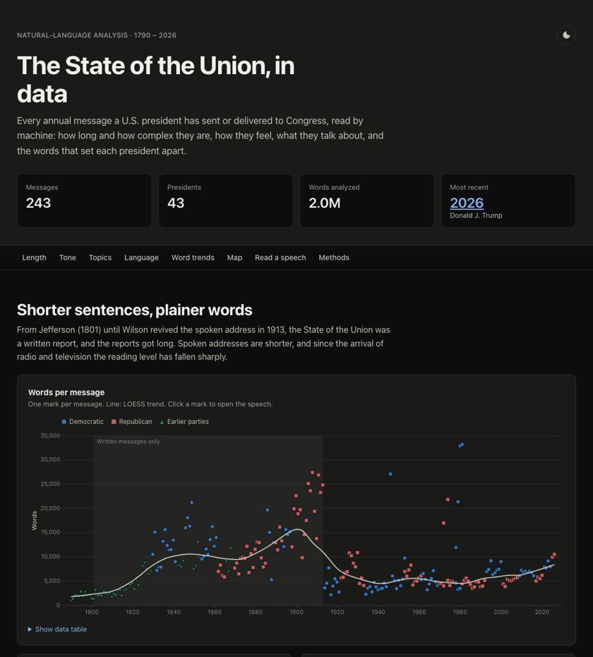

# The State of the Union, in data

Natural-language analysis of **every U.S. State of the Union message, 1790–2026**: 243 messages from 43 presidents, about 2 million words.

**Live site: <https://tiroger.github.io/NLP-SOTU/>**  ·  [](https://github.com/tiroger/NLP-SOTU/actions/workflows/pages.yml)



## Key findings

- **Plainer language.** Average Flesch–Kincaid grade level fell from about 19 in the 1790s to 16 around 1900, 12 in the 1950s and 8 in the 2020s.
- **The upbeat turn.** Net tone averaged slightly negative through the 19th century (−0.08 in the 1850s) and has been clearly positive since the 1940s (+0.14 in the 1950s, +0.16 in the 1980s), as the address moved to radio and television.
- **From "the Government" to "we."** First-person plural pronouns rose from about 10 per 1,000 words in the written-message era to about 40 after World War II.
- **New agendas.** Native American affairs, currency and territorial expansion all but vanish in the 20th century. Health care grows from under 1% of words before 1920 to about 10% in the 2020s, and immigration from about 1% to 4%.
- **More emphatic, not just happier.** After WWII the share of clearly upbeat sentences doubled (about 14% → 32%), but downbeat sentences never declined. At 20–21% today, they're as common as during the Depression. Net tone rose because neutral sentences fell from about 72% to 47%.
- **Parties sound alike.** Since 1965, Republican presidents average slightly more positive than Democratic ones (+0.157 vs. +0.132), but the gap is not significant (exact permutation test over presidents, p = 0.41, 6 vs. 5 presidents). The parties differ in vocabulary (Democrats: *jobs, middle class, families, college*; Republicans: *freedom, federal government, spending, defense*). But once each speech's era is removed, a speech's closest matches by other presidents are no more likely to share its party than chance (52% vs. 50%).

## What's in it

| Analysis | Method |
|---|---|
| Length, reading level, vocabulary richness | Word counts, Flesch–Kincaid grade, MTLD lexical diversity (length-robust) |
| Tone of every sentence | RoBERTa 3-class sentiment (`cardiffnlp/twitter-roberta-base-sentiment-latest`) |
| Emotion | DistilRoBERTa, Ekman's six + neutral (`j-hartmann/emotion-english-distilroberta-base`) |
| Policy topics by decade | `all-mpnet-base-v2` paragraph embeddings → logistic regression trained on Policy Agendas Project hand codes + Claude-labeled historical paragraphs ([validation report](data/validation/report.md)) |
| Words that define each president / party | Log-odds ratio with informative Dirichlet prior (Monroe, Colaresi & Quinn 2008) |
| Word & phrase trends | Per-speech unigram/bigram index, searchable in the browser |
| Speech similarity map | Speech embeddings → UMAP, plus an era-removed view (Gaussian-weighted era average subtracted); nearest neighbours and "kindred speeches from other eras" per speech |
| Places mentioned, “I” vs “we” | spaCy NER and pronoun rates |

Every chart is defined once in Altair ([`sotu/charts.py`](sotu/charts.py)). The marimo notebooks render the charts directly, and the build step exports them as Vega-Lite specs for the website.

## Repository layout

```
sotu/                 Python package
  scrape.py           Scrape the UCSB American Presidency Project index (requests + BeautifulSoup)
  text.py             Transcript cleaning, spaCy sentences/entities, style metrics
  models.py           Transformer tone, emotion and embedding models
  topics.py           Topic taxonomy (edit to change topics)
  process.py          Per-speech NLP with an on-disk cache (.cache/processed)
  build.py            Aggregation, statistics, site data + chart specs
  validate_topics.py  Topic-classifier validation (Policy Agendas benchmark + Claude-labeled history) and the classifier the build uses
  charts.py           Altair charts + palette
notebooks/            marimo notebooks (01 data · 02 EDA · 03 sentiment · 04 topics · 05 generator)
data/speeches.jsonl   The corpus: one JSON object per message (metadata + paragraphs)
data/derived/         Tidy outputs for analysis (speech features, sentence scores, paragraph topics)
data/validation/      Validation sample, Claude labels and the validation report
site/                 Static website deployed to GitHub Pages
tests/                pytest suite
```

## Running it

Requires [uv](https://docs.astral.sh/uv/). Python 3.12 is installed automatically.

```bash
uv sync                                   # install dependencies
uv run python -m sotu.scrape              # fetch any new messages (incremental)
uv run python -m sotu.process             # spaCy + transformers; ~20 min the first time on Apple silicon, cached after
uv run python -m sotu.build               # write site/data and site/charts
python -m http.server -d site 8000        # preview at http://localhost:8000
```

### Notebooks (marimo)

| Notebook | Contents |
|---|---|
| [`01_collect_data.py`](notebooks/01_collect_data.py) | Scraping, corpus overview, spoken vs. written, cleaning before/after |
| [`02_exploratory_analysis.py`](notebooks/02_exploratory_analysis.py) | Length, reading level, MTLD vs. unique words, distinctive words, word trends |
| [`03_sentiment_analysis.py`](notebooks/03_sentiment_analysis.py) | Tone and emotion, party comparison with permutation test and bootstrap CI, VADER cross-check |
| [`04_topics_and_similarity.py`](notebooks/04_topics_and_similarity.py) | Topic heatmap, classifier spot-checks, interactive UMAP map |
| [`05_speech_generator.py`](notebooks/05_speech_generator.py) | Party-specific Markov-chain speech generator |

```bash
uv run marimo edit notebooks/03_sentiment_analysis.py   # interactive editor
uv run marimo run notebooks/05_speech_generator.py      # app mode
```

The notebooks read the committed files in `data/` and `site/data/`, so they work right after cloning without re-running the models.

Tests: `uv run pytest`.

## Validating the topic classifier

The [validation report](data/validation/report.md) scores topic classifiers against the [Policy Agendas Project](https://comparativeagendas.net/us/datasets)'s hand-coded State of the Union sentences (1946–2025). Because nothing comparable exists before 1946, it also scores them against 750 paragraphs from every era labeled by Claude under a written rubric. Those labels were themselves checked: they agree with the human coders on 81% of the sentences Claude labels high-confidence, and 96.5% of labels are identical across two independent runs.

```bash
uv run python -m sotu.validate_topics sample     # fixed, seeded sample (already committed)
uv run python -m sotu.validate_topics label      # needs ANTHROPIC_API_KEY (e.g. in a git-ignored .env); about $9
uv run python -m sotu.validate_topics evaluate   # writes data/validation/report.md
```

With labels present, `sotu.build` uses the hybrid classifier. Without them it falls back to the description-centroid method.

## Adding next year's address

A scheduled workflow ([`check-new-speeches.yml`](.github/workflows/check-new-speeches.yml)) checks the archive monthly and opens an issue when a new message appears. Then:

```bash
uv run python -m sotu.scrape && uv run python -m sotu.process && uv run python -m sotu.build
git add data site && git commit -m "Add <year> address" && git push
```

Only the new speech goes through the models; everything else comes from the cache. Pushing changes under `site/` redeploys the site.

## Data source and caveats

Texts come from [The American Presidency Project](https://www.presidency.ucsb.edu/documents/presidential-documents-archive-guidebook/annual-messages-congress-the-state-the-union), UC Santa Barbara. The models were trained on modern English, so read scores for 18th- and 19th-century prose as rough trends. Most messages from 1801–1912 were written reports, not speeches, so compare eras with care.
